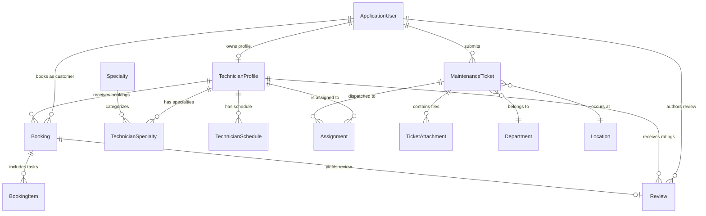

# Fixawyy — Smart Facility Maintenance & Service Booking Platform
> **Digital Egypt Pioneers Initiative (DEPI)** — Ministry of Communications and Information Technology (MCIT)  
> **Track:** Software Development (.NET Track)  
> **Target Framework:** .NET 10 | ASP.NET Core MVC | Entity Framework Core 10 | SQL Server | SignalR | QuestPDF  
> **Live Production URL:** [https://fixawyy.runasp.net](https://fixawyy.runasp.net)

---

## 🌟 Executive Summary & Project Vision

**Fixawyy** is an enterprise-grade maintenance management ecosystem and residential service marketplace built on **.NET 10** and **ASP.NET Core MVC**. The platform bridges two critical sectors of property and facility maintenance:

1. **B2C (Residential Service Marketplace):**  
   Empowers individual homeowners and tenants to seamlessly discover certified, background-checked technicians (electricians, plumbers, HVAC technicians, carpenters, painters, and appliance specialists), view transparent hourly rates and customer ratings, book specific service time slots, and leave verified reviews.

2. **B2B (Enterprise Facility Maintenance & Ticketing):**  
   Provides corporate offices, universities, medical centers, and shopping malls with a comprehensive **Computerized Maintenance Management System (CMMS)**. Employees and facility managers can submit maintenance requests with photos/documents, benefit from an automated multi-factor urgency prioritization algorithm, route tasks by department and physical location, and track incident resolution lifecycles.

3. **Operations Dispatcher & Real-Time Engine:**  
   Features an intelligent dispatching board that matches open maintenance tickets with the most qualified, available technician based on skill alignment, current workload capacity, and historical rating. Built-in **SignalR** WebSocket notifications alert staff and technicians in real time, while an **Executive Analytics Dashboard** delivers dynamic KPIs, visual charts, and automated **QuestPDF** report exports.

---

## 👥 Graduation Project Team Members & Contributions

| # | Team Member | Primary Role & Core Module | Key Responsibilities & Delivered Components |
|---|---|---|---|
| **1** | **Abdelrahman Mohamed Galal** | **Identity, Security & Technician Directory** | • ASP.NET Core Identity & Role-Based Access Control (RBAC)<br>• Account Registration, Login, and Password Management<br>• Email OTP Verification via custom `IEmailService`<br>• Technician Profiles, Hourly Rates, Specialties & Weekly Schedules<br>• Administrator User Management Dashboard (`/Admin/Users`) |
| **2** | **Bassel Amr Mahmoud** | **B2C Booking Engine & Customer Review System** | • Residential Technician Catalog & Filter Portal (`/Booking/Technicians`)<br>• Real-time Technician Availability & Slot Booking Engine<br>• Customer Self-Service Portal (`/Booking/MyBookings`)<br>• Technician Job Board & Schedule Tracker (`/Booking/TechnicianBookings`)<br>• Transparent Star-Rating & Review Engine (`/Review/Technician/{id}`) |
| **3** | **Mohamed Rashed Ramah** | **B2B Facility Maintenance & Smart Prioritization** | • Organization Maintenance Request Workflow (`/Maintenance`)<br>• Facility Hierarchy: Departments & Physical Locations<br>• Multi-Factor Smart Urgency Prioritization Algorithm (`PriorityCalculator`)<br>• Secure Attachment Management (`IAttachmentService`) with MIME validation<br>• Advanced Search, Multi-Filter, Sorting & Pagination System |
| **4** | **Abdelrahman Ahmed Fouad** | **Operations Dispatcher, SignalR Hub, Analytics & Cloud Architecture** | • Central Facility Dispatcher Operations Board (`/Dispatcher`)<br>• Smart Technician Matching & Auto-Assignment Algorithm<br>• Real-Time WebSockets Push Notification Hub (`/hubs/notifications`)<br>• Executive Analytics Engine & Chart.js Metrics (`/api/analytics`)<br>• Branded PDF Report Generation (QuestPDF) & CSV Data Export<br>• Cloud Hosting on MonsterASP & GitHub Actions CI/CD Pipeline |

---

### Detailed Breakdown of Individual Deliverables

#### 🔹 Teammate 1: Abdelrahman Mohamed Galal
* **Secure Authentication & Identity Architecture:** Configured ASP.NET Core Identity on `ApplicationUser`, establishing strict password complexity, unique email enforcement, and brute-force lockout mechanisms (5 max failed attempts with a 15-minute lockout window).
* **Two-Factor & OTP Verification (`EmailService`):** Integrated an asynchronous SMTP email delivery service utilizing Google Mail credentials to dispatch one-time verification passwords and account confirmation links.
* **Technician Directory & Profile Portal (`TechnicianController`):** Designed the technician showcase directory (`/Technician/Directory`), presenting technicians' bios, verified specialties, hourly rates, experience years, and daily working hours (`TechnicianSchedule`).
* **Super-Admin User Management (`AdminController`):** Developed an administrative management console (`/Admin/Users`) enabling administrators to view system users, toggle account statuses (active/inactive), and manage role assignments.

#### 🔹 Teammate 2: Bassel Amr Mahmoud
* **B2C Technician Booking Engine (`BookingController`, `BookingService`):** Created the full customer-facing booking journey where residential customers browse technicians by trade, view available calendar dates, specify needed repair services (`BookingItem`), and submit service appointments.
* **Dynamic Availability & Conflict Prevention:** Engineered logic to inspect existing technician schedules and active bookings, preventing double-booking of technician time slots.
* **Dual Booking Management Portals:**
  * **Customer Portal (`/Booking/MyBookings`):** Enables customers to monitor upcoming and completed jobs, view cost summaries, and trigger cancellations.
  * **Technician Portal (`/Booking/TechnicianBookings`):** Grants technicians visibility into incoming customer appointments and tools to mark appointments as in-progress or completed.
* **Verified Customer Review System (`ReviewController`, `ReviewService`):** Implemented a post-service rating system allowing customers who completed a booking to submit 1-to-5 star ratings and written feedback, automatically recalculating the technician's cumulative score and review count.

#### 🔹 Teammate 3: Mohamed Rashed Ramah
* **B2B Enterprise Ticketing Module (`MaintenanceController`, `MaintenanceRequestService`):** Architected the organization maintenance submission workflow allowing corporate employees, facility admins, and department heads to log detailed incident reports.
* **Facility Hierarchy (Departments & Locations):** Created full administrative CRUD modules for organizational structure (`DepartmentController` & `LocationController`), grouping assets across buildings, floors, and specific rooms (e.g., Server Rooms, Laboratories, Conference Rooms).
* **Smart Multi-Factor Prioritization Engine (`PriorityCalculator`):** Developed an algorithm that computes an incident's urgency score ($Score \in [20, 105]$) from three distinct operational vectors:
  $$\text{Priority Score} = \text{Impact Scope} + \text{Hazard Level} + \text{Location Criticality}$$
  * **Impact Scope:** Single Room (10), Entire Department (20), Whole Floor (35), Entire Building (50).
  * **Hazard Level:** Harmless (5), Minor Risk (15), Dangerous (25), Life Threatening (35).
  * **Location Criticality:** Storage (5), Office Space (10), Public / Lobby (15), Server Room / Laboratories (20).
  * *Classification Thresholds:* **Low** (<30) | **Medium** (30–59) | **High** (60–84) | **Critical** (≥85).
* **Secure Attachment Vault (`AttachmentService`):** Built file upload pipelines supporting photos and diagnostic documents (`.jpg`, `.jpeg`, `.png`, `.pdf`, `.doc`, `.docx`) up to 10 MB, stored securely outside the public web root (`App_Data/Attachments`) with strict authorization checks to prevent unauthorized data access.

#### 🔹 Teammate 4: Abdelrahman Ahmed Fouad
* **Operations Dispatcher Board (`DispatcherController`, `Views/Dispatcher/Index.cshtml`):** Engineered the single-pane command center for Facility Admins and Super Admins, displaying real-time ticket queues categorized into Pending, Assigned, and In-Progress.
* **Intelligent Technician Matching & Auto-Assignment (`TechnicianAssignmentService`):** Formulated an automated candidate-ranking algorithm:
  * **Specialty Match (40 pts):** Exact match with the required skill vs. cross-disciplinary alternative.
  * **Workload Balancing (35 pts):** Evaluates currently active jobs, favoring available staff and mitigating technician burnout:
    $$\text{Workload Score} = \max(0, (5 - \text{Active Jobs}) \times 7)$$
  * **Technician Rating (25 pts):** Rewards historically top-rated technicians based on verified customer feedback:
    $$\text{Rating Score} = \frac{\text{Rating}}{5.0} \times 25$$
* **Real-Time SignalR Notification Network (`NotificationHub`):** Integrated ASP.NET Core SignalR at `/hubs/notifications`, pushing live notifications across connected browser clients whenever new tickets arrive, assignments occur, or jobs are resolved.
* **Executive Analytics & Reporting Engine (`AnalyticsApiController`, `AnalyticsService`):** Built metrics aggregation for total volume, resolution duration averages, department breakdowns, status distributions, and technician league tables.
* **Automated Document Generation (QuestPDF & CSV):** Implemented instant tabular CSV downloads and styled, multi-page PDF generation with company branding, tables, KPI metric badges, and signatures using **QuestPDF**.
* **Cloud DevOps & Hosting:** Configured continuous deployment from GitHub to **MonsterASP.NET**, optimized IIS publishing profiles via WebDeploy, managed cloud SQL Server migrations, and enforced HTTPS/SSL certificates.

---

## 🛠️ Technology Stack & Architecture

| Layer | Technologies & Libraries |
|---|---|
| **Runtime & Framework** | C# 13, .NET 10 (`net10.0`), ASP.NET Core MVC (`Microsoft.NET.Sdk.Web`) |
| **Data Access & ORM** | Entity Framework Core 10, EF Core SQL Server Provider, EF Core Migrations |
| **Database Engine** | Microsoft SQL Server (Cloud hosted on MonsterASP.NET MSSQL 2025) |
| **Identity & Security** | ASP.NET Core Identity, Cookie Authentication, Anti-Forgery Tokens (CSRF) |
| **Real-Time WebSockets** | ASP.NET Core SignalR (`/hubs/notifications`) |
| **Document Generation** | QuestPDF `2026.9.2` (Community License) for PDF generation |
| **Front-End & UI** | Razor Views, Bootstrap 5.3.3, Bootstrap Icons 1.11.3, Chart.js, jQuery Validation |
| **Cloud Hosting & CI/CD** | MonsterASP.NET (IIS Windows Hosting), WebDeploy (MSDeploy), GitHub Actions |

---

## 🏛️ System Architecture & Entity Relationships

The application follows a clean modular design within an ASP.NET Core MVC project:

```text
Fixawyy/
├── Context/                # EF Core AppDbContext, Model Configurations & Database Seeders
├── Controllers/            # MVC Web Controllers & RESTful API Controllers
│   ├── AccountController.cs          # Authentication, OTP, Profile management
│   ├── AdminController.cs            # Super-Admin user and role management
│   ├── AnalyticsApiController.cs     # KPI endpoints, CSV/PDF export
│   ├── AssignmentApiController.cs    # Dispatcher suggestion & auto-assign APIs
│   ├── BookingController.cs          # B2C Technician discovery & booking
│   ├── DepartmentController.cs       # B2B Department management
│   ├── DispatcherController.cs       # Operations dispatch board
│   ├── LocationController.cs         # B2B Location management
│   ├── MaintenanceController.cs      # B2B Request creation & tracking
│   ├── MaintenanceRequestController.cs # B2B Request REST API
│   ├── ReviewController.cs           # Post-service customer reviews
│   └── TechnicianController.cs       # Technician directory & schedule display
├── DTOs/                   # Data Transfer Objects for API requests and responses
├── Hubs/                   # SignalR WebSocket Hubs (NotificationHub)
├── Migrations/             # EF Core database migrations & model snapshot
├── Model Views/            # Strongly-typed Razor ViewModels
├── Models/                 # Database entities (MaintenanceTicket, Booking, Review, etc.)
├── Properties/             # Launch settings & MonsterASP WebDeploy publish profile
├── Services/               # Business logic, Priority calculation, Analytics, PDF generator
├── Views/                  # Razor templates organized by controller
└── wwwroot/                # Static assets (CSS, JavaScript, uploaded images, libraries)
```

### Core Entity Relationships



---

## 🔐 Role-Based Access Control (RBAC) Matrix

| Feature / URL | `Admin` | `FacilityAdmin` | `Employee` | `Technician` | `Customer` |
|---|:---:|:---:|:---:|:---:|:---:|
| **User & Role Administration** (`/Admin/Users`) | ✅ Full | ❌ | ❌ | ❌ | ❌ |
| **Operations Dispatcher Board** (`/Dispatcher`) | ✅ Full | ✅ Scoped | ❌ | ❌ | ❌ |
| **Executive Analytics & PDF Reports** (`/api/analytics/*`) | ✅ Full | ✅ Scoped | ❌ | ❌ | ❌ |
| **Department & Location Management** (`/Department`, `/Location`) | ✅ Full | ✅ Full | ❌ | ❌ | ❌ |
| **Submit B2B Maintenance Request** (`/Maintenance/Create`) | ✅ | ✅ | ✅ | ❌ | ❌ |
| **View Owned B2B Requests** (`/Maintenance`) | ✅ (All) | ✅ | ✅ (Own) | ❌ | ❌ |
| **B2C Book a Technician** (`/Booking/Create`) | ❌ | ❌ | ❌ | ❌ | ✅ |
| **Track Residential Bookings** (`/Booking/MyBookings`) | ❌ | ❌ | ❌ | ❌ | ✅ |
| **Submit Customer Reviews** (`/Review/Create`) | ❌ | ❌ | ❌ | ❌ | ✅ |
| **Technician Jobs Portal** (`/Booking/TechnicianBookings`) | ❌ | ❌ | ❌ | ✅ | ❌ |
| **Public Technician Directory** (`/Technician/Directory`) | ✅ | ✅ | ✅ | ✅ | ✅ |

---

## 🚀 Live Demo & Seed Test Credentials

The application is deployed live with an initialized, fully-seeded cloud database:

🌐 **Live URL:** [https://fixawyy.runasp.net](https://fixawyy.runasp.net)

### Ready-to-Use Demo Accounts:

| Role | Email Address | Password | Intended Test Flow |
|---|---|---|---|
| **Super Admin** | `admin@fixawyy.com` | `Admin@123456` | Full platform access, User management, Dispatcher, Global Analytics |
| **Facility Admin** | `engineering.admin@fixawyy.com` | `Admin@123456` | Facility-specific maintenance dispatching, Work order assignment |
| **Facility Employee** | `employee@fixawyy.com` | `Employee@123456` | Submitting B2B maintenance complaints with photos and priority scoring |
| **Lead Electrician** | `technician@fixawyy.com` | `Tech@123456` | Technician view, Assigned jobs, Schedule, Directory profile |
| **Master Plumber** | `khaled.plumber@fixawyy.com` | `Tech@123456` | Specialized plumbing work orders and customer bookings |

---

## 💻 Local Setup & Development Instructions

### Prerequisites
* [.NET 10 SDK](https://dotnet.microsoft.com/download/dotnet/10.0)
* [SQL Server](https://www.microsoft.com/sql-server) or SQL Server LocalDB
* Visual Studio 2022+ / VS Code with C# Dev Kit
* EF Core CLI Tools:
  ```powershell
  dotnet tool install --global dotnet-ef
  ```

### Step-by-Step Installation

1. **Clone the Repository:**
   ```powershell
   git clone https://github.com/afouda22/Fixawy.git
   cd Fixawy
   ```

2. **Restore NuGet Dependencies:**
   ```powershell
   dotnet restore Fixawyy.csproj
   ```

3. **Configure Connection String:**
   Use .NET User Secrets to set your local database connection:
   ```powershell
   dotnet user-secrets init
   dotnet user-secrets set "ConnectionStrings:DefaultConnection" "Server=(localdb)\MSSQLLocalDB;Database=FixawyyDb;Trusted_Connection=True;MultipleActiveResultSets=true;TrustServerCertificate=True;"
   ```

4. **Apply Entity Framework Migrations:**
   ```powershell
   dotnet ef database update
   ```

5. **Build and Run the Application:**
   ```powershell
   dotnet build
   dotnet run
   ```

6. **Navigate in Browser:**
   Open [http://localhost:5270](http://localhost:5270) or [https://localhost:7139](https://localhost:7139).  
   *Note: On first startup, the database automatically seeds default roles, specialties, sample technicians, and demo maintenance tickets.*

---

## 📡 API Reference Summary

### 1. Operations Dispatcher API (`/api/assignment`)
* `GET /api/assignment/pending-tickets` — Retrieve all open tickets ordered by priority score.
* `GET /api/assignment/suggestions/{ticketId}` — Calculate top matching technicians based on skill, workload, and rating.
* `POST /api/assignment/auto-assign/{ticketId}` — Automatically assign the optimal technician and broadcast a SignalR alert.
* `POST /api/assignment/manual-assign` — Manually assign a specific technician (`{ ticketId, technicianId, notes }`).
* `POST /api/assignment/resolve/{assignmentId}` — Mark a work order as resolved and update completion timestamps.

### 2. Executive Analytics API (`/api/analytics`)
* `GET /api/analytics/kpi-summary` — Real-time metrics (Total tickets, Pending, In-Progress, Resolved, Average resolution hours).
* `GET /api/analytics/by-department` — Distribution of work orders across organizational departments.
* `GET /api/analytics/by-status` — Work order breakdown by current operational status.
* `GET /api/analytics/technician-rankings` — Performance league table of technicians (jobs closed, current workload, ratings).
* `GET /api/analytics/export/csv` — Stream dynamically generated CSV report.
* `GET /api/analytics/export/pdf` — Download a branded, formatted PDF maintenance summary generated by QuestPDF.

### 3. B2B Maintenance Request API (`/api/MaintenanceRequest`)
* `POST /api/MaintenanceRequest` — Submit a new maintenance ticket with priority parameters.
* `GET /api/MaintenanceRequest/my-requests` — Fetch all maintenance tickets submitted by the authenticated user.
* `GET /api/MaintenanceRequest/{id}` — Fetch detailed information of a specific maintenance ticket.

---

## 📄 License & Academic Attribution
Developed as the official graduation project for the **Digital Egypt Pioneers Initiative (DEPI)**, Software Development Track (.NET & Web Development), under the supervision of the Ministry of Communications and Information Technology (MCIT), Egypt.
